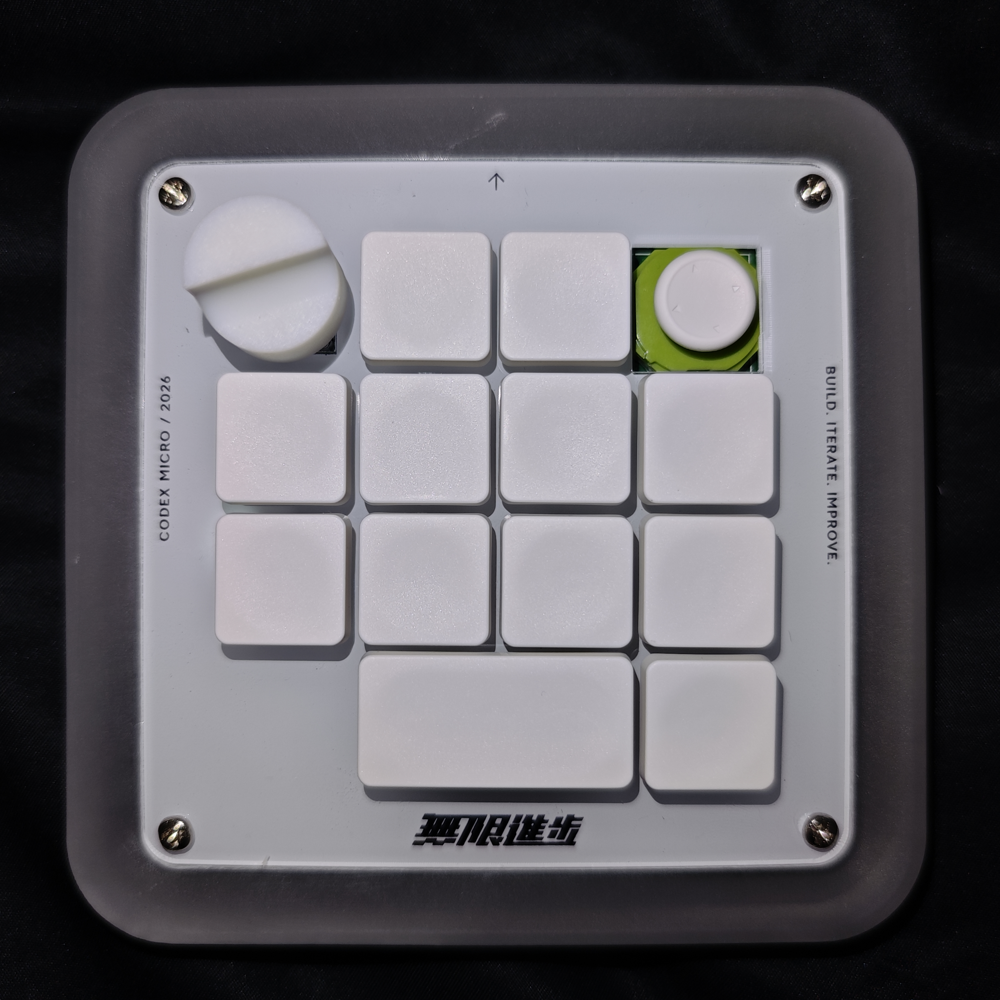

# Codex AI 键盘 · 开源复刻

**从两块电路板，到一块可以自己组装的桌面控制台。**

ESP32-S3 N16R8 · 12 个按键 · EC11 旋钮 · 双轴摇杆

[开始复刻](docs/01-start.md) · [硬件与 BOM](hardware/README.md) · [下载烧录包](https://github.com/kiki348/codex-micro-diy/releases) · [下载配置软件](https://github.com/kiki348/codex-micro-diy/releases)

这里整理的是基于 wlk6655 开源设计的 DIY 实现：工程文件、两板 BOM、制作路线、装配容易踩的坑，以及首次烧录与后续升级的区别。不是官方产品。

硬件与固件资料公开，Windows 配置软件提供完整发行包，桌面软件源码保持闭源。工程源文件在仓库，首次烧录、OTA、恢复与 Windows ZIP 从 [Releases](https://github.com/kiki348/codex-micro-diy/releases) 下载。

## 第一次来，从这里开始

| 你想做什么 | 入口 |
|---|---|
| 判断自己是否适合复刻 | [工具、材料与路线](docs/01-start.md) |
| 对照物料和历史采购 | [采购指南](docs/02-procurement.md) |
| 制作 PCB、外壳和面板 | [打样指南](docs/03-manufacturing.md) |
| 焊接与组装 | [装配指南](docs/04-assembly.md) |
| 首次烧录、升级、恢复 | [烧录指南](docs/05-flashing.md) |
| 配置键位与灯光 | [软件使用](docs/06-software.md) |
| 遇到问题 | [常见故障](docs/07-troubleshooting.md) |

## 可以拿走什么

- 嘉立创EDA工程包含控制板、键轴板、盖板和原理图。
- 从实际 PCB 元件提取的 BOM/CPL 审计清单，逐项列明未确认字段。
- 外围、下壳、底板 STEP，以及面板印刷文件。
- `.18` 适配固件源码、完整首次烧录包、OTA 升级包与恢复包。
- Windows x64 配置软件完整运行包。
- 采购、打样、焊接、装配、烧录路线与已知风险说明。

## 当前验证范围

已有实体设备运行 `.18` 的记录、配置写入与设备回读证据，12 键有累计按下/松开计数。空白板首次启动、第二台干净 Windows 电脑、全部实体输入到 Codex 的同次响应尚未全部验证。详细范围见[验证记录](docs/validation.md)。

首版为预发布：硬件源工程已提供；当前板图与原理图的一项网表差异待核对，尚未附核查通过的当前版 Gerber。见[制板状态](hardware/gerber/STATUS.md)。

如果资料帮你少走了弯路，欢迎 **Star** 留存，也欢迎提交有证据的 BOM 修正和复刻记录。

## 来源与许可

上游设计：[wlk6655 / 复刻版兼容codex micro](https://oshwhub.com/wlk6655/project_arhgqemg)。本仓库负责整理、适配说明和发布工具；不将上游原始设计标为本项目独立原创。各目录分别遵循[许可与第三方说明](THIRD_PARTY_NOTICES.md)。
